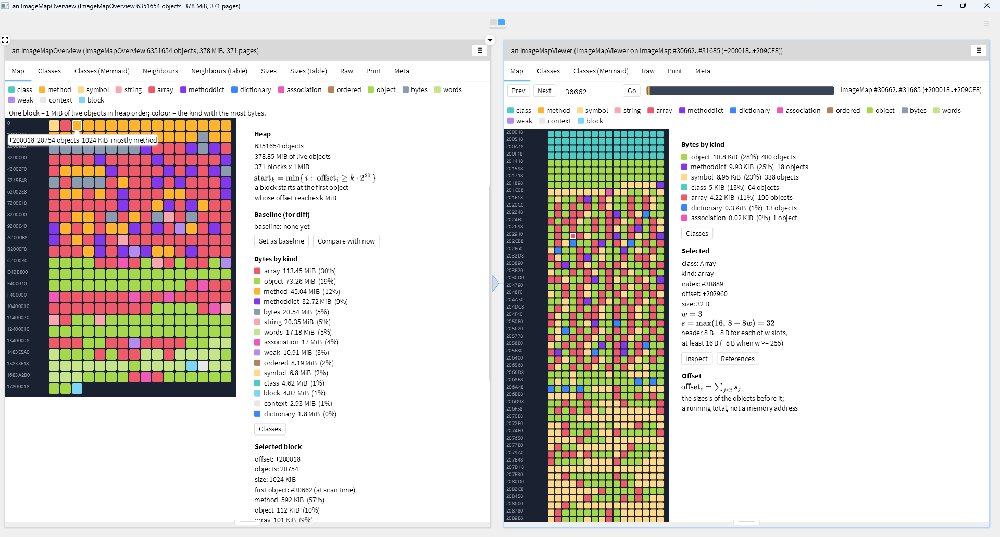

# ImageMap

A block-map view of the inside of a running Pharo image, for [Glamorous Toolkit](https://gtoolkit.com).

Every block is one object (or one page of objects), and its colour is the kind of object it is: classes, compiled methods, symbols, strings, arrays, method dictionaries, and so on. Walking the image this way makes its structure visible: where the class and method data sit, what the heap is made of, and what a change to the image added or released.

> **Status: experimental.** ImageMap is a study of the object memory of a Pharo image, and it is at an early stage. The code was written together with Claude (Anthropic's AI assistant), and I am reading it at my own pace to understand both the code and what it shows. Parts of it may be wrong or may not behave as I describe, and the numbers should not be taken as exact. The API and the look of the views may change without notice. Please read it as a work in progress and not as a finished tool. Corrections and comments are welcome: [issues](https://github.com/iriyak/ImageMap/issues).



*The overview of the whole heap (left), and the window opened from the selected block with* Open window here *(right).*

## What you get

**Window** (`ImageMapViewer`). 1024 consecutive objects, 16 per row, in the order `SystemNavigation>>allObjectsDo:` visits them. The label at the start of each row is the running byte offset. Hover a block to see its object, click to select it, and press *Inspect* to open the object in an inspector. *Prev*, *Next*, a start-index field and a position bar move the window. The *Classes* and *References* buttons in the side panel open diagrams (see below).

**Overview** (`ImageMapOverview`). The whole heap in one picture. One block is one page of 1 MiB of live objects, coloured by the kind that takes the most bytes. The side panel shows the bytes per kind for the whole heap and the details of the selected page, a *Classes* button opens the *Classes* tab, and *Open window here* opens a window at the start of that page.

**Diff** (`ImageMapDiff`, experimental). Compares the heap now with a baseline taken earlier, page by page. Filled blocks grew, outlined blocks shrank, and the colour is the kind that changed most. The side panel lists the change by kind and the biggest class changes.

**Diagrams** (need [Pele2svg](https://github.com/iriyak/pele2svg), see Requirements). These tabs draw a Mermaid diagram next to a table or the Mermaid source: The nodes of the sankey diagrams have the colour of their kind, the same as in the legend and in *Bytes by kind*.

- *Classes* (in an `ImageMapOverview`): the bytes of the heap as a sankey diagram: the whole heap, its kinds, and the classes that take at least 1% of it. *Classes (Mermaid)* is its source.
- *Classes* (in a window, an `ImageMapSnapshot`; the *Classes* button in the side panel of the window opens it): the same sankey for the objects of the window, with the 14 classes that have most bytes named, in KiB.
- *Neighbours* (in an `ImageMapOverview`): which kind of object follows which in heap order, as a flow between the kinds. *Neighbours (table)* has the numbers.
- *Sizes* (in an `ImageMapOverview`): the objects and the bytes by size class (powers of two), as two bar charts. *Sizes (table)* has the numbers. Neighbours and Sizes are counted in the scan of the overview, so an overview from an older scan shows a message instead.
- *Class changes* (in an `ImageMapDiff`): the classes whose bytes changed most, as a horizontal bar chart. *Class changes (table)* lists all of them.
- *References* (the button in the side panel of a window): the selected object as a diagram, with its class and superclass chain, and what its slots point to (at most 24 slots; the literals of a compiled method). Its *Slots* and *Mermaid* tabs work without Pele2svg.

Kinds and colours: `class`, `method`, `symbol`, `string`, `array`, `methoddict`, `dictionary`, `association`, `ordered`, `object`, `bytes`, `words`, `weak`, `context`, `block`.

## Requirements

Glamorous Toolkit (Bloc, Brick and Phlow). ImageMap was developed and tried on GT v1.1.624 (Pharo 13.1, 64-bit Spur, Windows). Other versions and platforms have not been tried.

[Pele2svg](https://github.com/iriyak/pele2svg) and Node.js 20 or newer draw the Mermaid diagrams. They are loaded by default; without them those tabs say so and everything else works.

The side panels also show three small formulas (the size of the selected object, the offset, the start of a block) rendered with Pele2svg's math support. That support is newer than Pele2svg v0.3.0, so it needs the `main` branch of Pele2svg; with an older one the formulas are left out and nothing else changes.

## Installation

Run the two steps one after the other, each in its own Playground (`Pele2svg` does not exist until the first one has finished).

1. Load ImageMap. This also loads Pele2svg (with its tests), which draws the diagrams:

```smalltalk
Metacello new
	repository: 'github://iriyak/ImageMap:main/src';
	baseline: 'ImageMap';
	load
```

2. Install the dependencies of Pele2svg once. This needs Node.js 20 or newer:

```smalltalk
Pele2svg installDependencies
```

## Lepiter

The repository has a Lepiter database in `lepiter/`, with the page *Getting started with ImageMap in GT*. It holds runnable snippets for the three views. To register the database in your image:

```smalltalk
BaselineOfImageMap loadLepiter.
```

Then open the Lepiter book and search for "ImageMap".

## Usage

Open a window at a given object index:

```smalltalk
ImageMapViewer openAt: 5000000.
```

Open the overview (it scans the heap first, which takes a few seconds):

```smalltalk
ImageMapOverview open.
```

Compare the heap with an earlier state:

```smalltalk
"1. take a baseline"
ImageMapDiff takeBaseline.

"2. do whatever you want to measure: load a package, run a tool, ..."

"3. compare with now"
ImageMapDiff open.

"drop the baseline"
ImageMapDiff clearBaseline.
```

The overview side panel has the same two steps as buttons: *Set as baseline* and *Compare with now*.

Try the diff with something you can see, then release it:

```smalltalk
ImageMapDiff takeBaseline.
Smalltalk globals at: #ImageMapDiffProbe put: {
	ByteArray new: 16 * 1048576.
	(1 to: 150000) collect: [:i | i -> i printString] }.
ImageMapDiff open.

"when you have looked at it"
Smalltalk globals removeKey: #ImageMapDiffProbe.
ImageMapDiff clearBaseline.
Smalltalk garbageCollect.
```

The data objects can be used without the views:

```smalltalk
(ImageMapSnapshot start: 5000000 count: 1024) inspect.
ImageMapOverview scan inspect.
ImageMapDiff against: ImageMapOverview scan.
```

`open` and `openAt:` open their windows in the UI process, so they can be called from any process.

## Things to know

- **Offsets are not addresses.** The offset is the running total of `sizeInMemory` over the live objects, in visiting order. Free chunks are not counted.
- **Positions move.** Object indexes and offsets change after every garbage collection. An overview page therefore keeps a weak reference to its first object, and *Open window here* looks the object up again to find its current index.
- **The overview collects garbage first.** `ImageMapOverview scan` runs a full garbage collection, so the picture shows live objects only.
- **The diff follows anchors.** The first object of every baseline page is an anchor. The diff walks the heap now, recognises the anchors one after another, and counts what lies between them. A page whose anchor has been collected is folded into the page before it, and objects added after the last baseline page appear as `new` blocks. If the heap order of the anchors has changed, the side panel says so.
- **Only reading.** The scans read each object's class and size. They do not modify the objects.

How the object memory is read, and the logic behind the three views, is described in [docs/IMPLEMENTATION.md](docs/IMPLEMENTATION.md).

## License

MIT. See [LICENSE](LICENSE).
